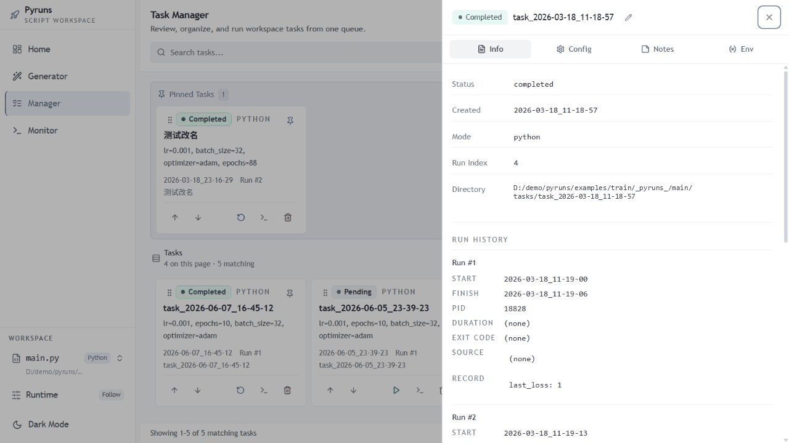

# 配置说明

Pyruns 的配置不是“堆一页键值对”。  
它更像三层互相咬合的结构：

1. workspace 级配置
2. task 级数据
3. shell runtime 策略

理解了这三层，很多行为都会一下子变得顺理成章。



Pyruns 0.3.14 支持 OmegaConf 2.3 和 2.4，均保留 Pyruns 的批量范围、科学计数法和未解析插值语义。
OmegaConf 2.4 会拒绝同一映射中同时出现整数键 `1` 和字符串键 `"1"`；请为它们使用不重复的名称。
2.4 的 YAML 别名展开限制也会保留，具体变化见 [上游升级说明](https://omegaconf.cli.dev/docs/migration/2.4)。

## 1. 两个最重要的概念

### `workspace_kind`

表示当前打开的工作区是什么：

- `script`
- `shell`

### `task_kind`

表示任务实际保存和执行的内容是什么：

- `python`
- `shell`

这两个概念不要混淆：

- `workspace_kind` 影响页面能力和默认编辑模式
- `task_kind` 影响任务文件结构和执行方式

## 2. 工作区目录结构

先看一句最重要的话：

- `script` workspace 围绕一个 Python 脚本组织
- `shell` workspace 围绕一个目录里的命令任务组织

## 2.5 Script vs Shell：配置层面的区别

| 项目 | `script` 模式 | `shell` 模式 |
| --- | --- | --- |
| 工作区对象 | 一个 Python 脚本 | 一个目录 |
| 常见入口 | `pyr init train.py` | `pyr init` |
| 任务文件 | `config.yaml` | `config.ps1` / `config.cmd` / `config.sh` |
| 典型用途 | 脚本调参、模板配置、批量实验 | 命令任务、批处理、终端工作流 |
| 运行重点 | 参数配置与脚本运行 | 原生命令执行 |
| `__PYRUNS_CONFIG__` | 可能使用 | 不使用 |

如果你在犹豫该选哪一个，经验上可以这样判断：

- 只要你有明确的 Python 入口脚本，优先选 `script`
- 只有当你真正想管理的是“目录里的命令任务”时，再选 `shell`

### Script Workspace

```text
_pyruns_/
├─ _pyruns_settings.yaml
└─ main/
   ├─ script_info.json
   ├─ config_default.yaml
   └─ tasks/
```

### Shell Workspace

```text
_pyruns_/
├─ _pyruns_settings.yaml
└─ _shell_/
   ├─ script_info.json
   └─ tasks/
```

## 3. 任务目录结构

### Python 任务

```text
tasks/<task_name>/
├─ task_info.json
├─ tracks.sqlite3       # 曲线较大时自动创建
├─ config.yaml
├─ run_logs/
   ├─ run1.log
   ├─ run2.log
   └─ error.log
└─ artifacts/
   └─ run1/
```

### shell 任务

```text
tasks/<task_name>/
├─ task_info.json
├─ tracks.sqlite3       # 曲线较大时自动创建
├─ config.ps1 | config.cmd | config.sh
├─ run_logs/
   ├─ run1.log
   ├─ run2.log
   └─ error.log
└─ artifacts/
   └─ run1/
```

注意：

- shell payload 文件名由当前 runtime 决定：PowerShell 通常是 `config.ps1`，cmd 是 `config.cmd`，bash / sh / zsh 是 `config.sh`
- 变化的是 payload 文件名与执行 wrapper，不是任务模型
- `artifacts/runN/` 只在脚本通过 `pyruns.artifact_dir()` 写入时创建

## 4. `script_info.json`

### Script Workspace 示例

```json
{
  "workspace_kind": "script",
  "script_name": "train",
  "script_path": "D:/project/train.py"
}
```

### Shell Workspace 示例

```json
{
  "workspace_kind": "shell",
  "script_name": "_shell_",
  "script_path": ""
}
```

## 5. `task_info.json`

无论是 Python 任务还是 shell 任务，都会保留统一的生命周期元信息。

典型字段如下：

```json
{
  "name": "task_001",
  "status": "pending",
  "progress": 0.0,
  "created_at": "2026-03-19_12-00-00",
  "task_kind": "python",
  "config_file": "config.yaml",
  "start_times": [],
  "finish_times": [],
  "pids": [],
  "records": [],
  "tracks": []
}
```

对于 shell 任务：

```json
{
  "task_kind": "shell",
  "config_file": "config.ps1"
}
```

`config_file` 也可能是 `config.cmd` 或 `config.sh`，取决于 shell runtime。

较大的 `track()` 历史保存在同目录的 `tracks.sqlite3`。此时 `task_info.json`
包含内部 `track_store` 版本和代次指针，`tracks` 只保留运行槽位。读取完整曲线请使用
`pyruns.load_task_info(task_dir)` 或 CLI `show`，不要仅解析 JSON 的 `tracks` 字段。
`records` 和生命周期字段继续存放在 JSON 中，16 MiB 元数据上限不再包含外置曲线。

备份和移动任务时应包含整个任务目录。为得到一致的备份，应先停止该任务及其写入进程。
数据库使用 SQLite 回滚日志和完整同步；任务重命名、移入回收站、恢复时会随目录移动。
已迁移的工作区需要使用 0.3.9 或更新版本读取曲线。

## 6. `_pyruns_settings.yaml`

位置：

```text
<project>/_pyruns_/_pyruns_settings.yaml
```

当前默认模板大致包含这些键：

```yaml
ui_port: 8099
header_refresh_interval: 3

monitor_chunk_size: 50000      # bytes per incremental log response
monitor_scrollback: 10000      # retained terminal rows and expanded history
monitor_sidebar_width_pct: 14

log_enabled: false
log_level: INFO

shell_mode: follow
shell_executable: ""

python_executable: ""
conda_env: ""
conda_executable: conda
global_env: {}

# GPU scheduler / GPU wait defaults
gpu_scheduler_enabled: false
gpu_scheduler_task_mode: single
gpu_scheduler_selection_mode: auto
gpu_scheduler_gpus_per_task: 1
gpu_scheduler_device_ids: []
gpu_scheduler_min_free_memory_gb: 8
gpu_scheduler_min_idle_pct: 70
gpu_scheduler_stable_seconds: 15
gpu_scheduler_max_wait_seconds: 172800
gpu_scheduler_respect_cuda_visible_devices: true
gpu_scheduler_require_same_gpu_model: false
```

网页启动任务时，先继承 `pyr ui` 的进程环境，再依次应用 Runtime 的 `global_env` 和 Details 中的任务 Env。GPU 调度开启时，本轮分配的 `CUDA_VISIBLE_DEVICES` 随启动环境传入脚本。脚本里的显式赋值在执行到该行时生效。

Env 编辑器支持 `KEY=value`、`export KEY=value`、单双引号和注释，变量值按字面保存。需要 Bash 默认值时，把 `export CUDA_VISIBLE_DEVICES="${CUDA_VISIBLE_DEVICES-4}"` 写在脚本里。只有外层完全未设置该变量时才使用 `4`，显式空值会保留。

直接使用 CLI 时，基础值来自调用终端。`pyr exec` 可用 `-e` 或 `--env-file` 覆盖同名变量。`pyr run` 重跑时应用该任务已保存的 Env。两者随后执行脚本。网页 Runtime 的 `global_env` 只用于网页启动的任务。

## 7. 重点配置项

### `header_refresh_interval`

- 控制 Dashboard/Header 的轮询刷新频率
- 单位秒
- 最小值实际会被钳制到 `1`

### `monitor_sidebar_width_pct`

- 控制 Monitor 左侧任务栏宽度百分比
- 当前前端直接按百分比使用
- 默认值现在是 `14`
- 不再额外做最小值 / 最大值限制

Manager 的并发数不是持久设置。CLI 在每次批量运行时用 `run -j/--jobs`
明确选择；Web UI 则在当次批量运行面板中填写 Workers。这样配置文件不会保留
一个与实际操作不一致的隐式并发策略。

### `shell_mode`

可选值：

- `follow`
- `custom`

语义：

- `follow`：默认，跟随调用 `pyr` 或启动 Web UI 时的当前终端
- `custom`：显式指定 `shell_executable`

### `shell_executable`

只有在 `shell_mode: custom` 时才会生效。

### GPU scheduler / GPU 空闲等待

这些 `gpu_scheduler_*` 键是 Web UI Runtime 的持久化设置，保存在项目的
`_pyruns_settings.yaml` 中。常用设置如下：

| 设置 | 作用与单位 |
| --- | --- |
| `gpu_scheduler_enabled` | `true` 时，后续从 UI 提交的任务等待 GPU；`false` 时直接按普通运行流程提交 |
| `gpu_scheduler_task_mode` / `gpu_scheduler_gpus_per_task` | 内部兼容字段；UI 用 `GPUs required` 统一表达一次任务需要的卡数 |
| `gpu_scheduler_selection_mode` / `gpu_scheduler_device_ids` | `auto` 自动选择，或 `specified` 配置固定的物理 GPU 编号列表 |
| `gpu_scheduler_min_free_memory_gb` | 每卡最低空闲显存，单位 GiB，默认 8 |
| `gpu_scheduler_min_idle_pct` | 每卡最低空闲率，单位百分比，默认 70；空闲率为 `100 - GPU utilization` |
| `gpu_scheduler_stable_seconds` | 连续达标时间，单位秒，默认 15；0 表示立即启动 |
| `gpu_scheduler_max_wait_seconds` | 最长排队时间，单位秒，默认 172800（48 小时）；0 表示不限时 |
| `gpu_scheduler_respect_cuda_visible_devices` | 是否尊重任务的 `CUDA_VISIBLE_DEVICES`，默认开启 |
| `gpu_scheduler_require_same_gpu_model` | 多 GPU 任务是否要求同型号，默认关闭 |

UI 保存后只影响之后从 UI 提交的任务，不回溯修改已排队或运行中的任务，也不替 CLI 的一次性 `--gpu-wait` 规则。旧配置中的利用率上限会迁移为空闲率下限；UI 不再显示 `tasks per GPU` 或 `GPU per task` 两个容易混淆的独立字段。

## 8. shell 任务执行约束

当前 shell 任务的执行规则非常明确：

- 任务正文直接来自 `config_file` 指向的 shell payload 文件
- 不读取 `config.yaml`
- 不注入 `__PYRUNS_CONFIG__`
- 继续继承当前 Python 进程环境

这意味着 shell 任务更接近：

> “在调用 `pyr` 或启动 Web UI 的那个终端里，再执行一次同样的命令文本”

### Windows

- 默认跟随 PowerShell 或 cmd
- 会用原生 wrapper 把 `config.ps1` 或 `config.cmd` 内容交给对应终端执行
- 后台 runner 和任务进程不会创建额外控制台窗口
- 不做 bash 语法模拟

### Linux / macOS

- 默认跟随当前 shell
- 直接按当前 shell 语义执行

## 9. Python 任务执行约束

Python 任务仍然是脚本工作区的主链路：

- 每个任务有自己的 `config.yaml`
- executor 会注入 `__PYRUNS_CONFIG__`
- `pyruns.load()` / `pyruns.read()` 读取的是该任务自己的配置文件

## 10. 搜索与过滤

Manager 和 Monitor 使用相同的搜索设置，交互和默认值参考 VS Code。

语义是：

- 默认按连续文本搜索，不区分大小写；字段默认 `All fields`，也可单独选择任务名、Notes、Env 或 Logs；Python 工作区额外显示 `Config`，Shell 工作区额外显示 `Shell script`
- `Config` 搜索解析后的配置键和值，嵌套字段显示为 `model.name: value`，空字典、`null`、布尔值和列表均可搜索；不搜索 YAML 注释和排版。`Shell script` 搜索 Shell 任务的脚本内容；不检索 Python 源代码
- `Env` 搜索任务自身设置的环境变量键和值（`KEY=value`），不包含服务器进程继承的环境或工作区全局 Env
- `Logs` 检索 `run_logs` 中完整的 `run*.log`、`error.log` 和 `queue.log`；选择其他单独字段时不会扫描日志
- `Aa` 区分大小写、`ab` 全词匹配、`.*` 正则表达式可以组合使用，并与字段选择组合；搜索框内支持 `Alt+C`、`Alt+W`、`Alt+R` 切换
- 结果按任务、字段或日志文件分组，显示匹配片段与高亮；日志结果附带行号，点击后按需读取附近内容

全局搜索直接读取磁盘日志，不受 Monitor 终端的 4 MB 加载上限或滚动缓冲区限制。终端内的 Ctrl+F 只查已加载的终端内容。

普通文本按原样匹配，保留空格和换行，默认不区分大小写。`Enter` 立即搜索，`Shift+Enter` 插入换行，也可以粘贴多行文本。多行查询匹配同一字段或同一个日志文件内的连续文本，不会把不同字段、不同历史日志拼接起来。普通文本和全词搜索使用 Unicode 单字符大小写折叠，`ß` 不会被展开为 `ss`。

正则支持分组、或条件及前后查找；实际换行及未转义的 `\n`、`\r`、`\W` 会启用多行搜索。全词模式参考 VS Code 的模式边界处理：在模式首尾为 ASCII 字母、数字或下划线时添加词边界。元数据使用 Python `regex`，完整日志使用 ripgrep，并在需要时启用 PCRE2。高级语法仍受引擎差异影响，例如日志不支持无限长度后向查找，字符类和后向查找内的换行也不会自动改写为 CRLF。

日志按原始 UTF-8 内容搜索，ANSI 颜色转义仅从预览中移除。无效表达式、读取失败或超出搜索处理限制会显示错误；单条匹配日志产生的 JSON 结果上限为 16 MiB，这不是整个日志文件的大小上限。

搜索框旁的筛选按钮用于选择字段和匹配方式。持久设置集中在侧栏底部的 `Preferences`，可按 `Ctrl/Cmd+,` 打开，也可从筛选面板的 `Search preferences…` 进入。外观与搜索设置自动保存在当前浏览器，Manager 与 Monitor 共用；输入延迟和匹配上限位于默认折叠的 `Advanced search`：

| 设置 | 默认值 | 作用 |
| --- | --- | --- |
| Search as you type | 开启 | 输入后自动搜索；关闭后按 Enter 搜索 |
| Typing delay (ms) | 300 | 连续输入结束后等待的毫秒数 |
| Match limit | 20,000 | 全部所选字段合计的匹配上限；留空表示不限制 |

两页均支持 `Ctrl/Cmd+Shift+F` 聚焦搜索，以及在输入首行/末行用 `↑`/`↓` 复用历史查询。最近 100 条非空查询去重后保存在浏览器本地，保留原始空格和换行；自动搜索的历史等待 2 秒再记录，按 Enter 则立即记录。`Preferences` 中的 `Clear search history` 可清空历史，`Reset search settings` 恢复上表默认值。

结果分批显示。达到匹配上限后会停止扫描并提示“可能还有结果”，可选择不限制数量重新搜索；此时任务总数仅代表已找到的任务。单个任务的预览数量另有限制，匹配计数可以大于预览数量。取消会停止当前搜索并保留已返回的结果。

搜索期间不再定时重扫当前查询；任务变化或日志追加后，可手动刷新搜索结果。Monitor 选中任务的状态和日志仍会正常更新。大日志首次搜索仍需读取文件；未变化日志可以复用缓存，但目录枚举和文件信息检查仍有开销，NFS 的实际速度取决于服务端与网络。

如果你要补一张“配置是怎么落到任务里的”展示图，最值得补的是：

- `Info` 与 Run History 详情面板截图
- `Config` 中的 `config.yaml` / shell payload 截图
- `Env` 面板截图
