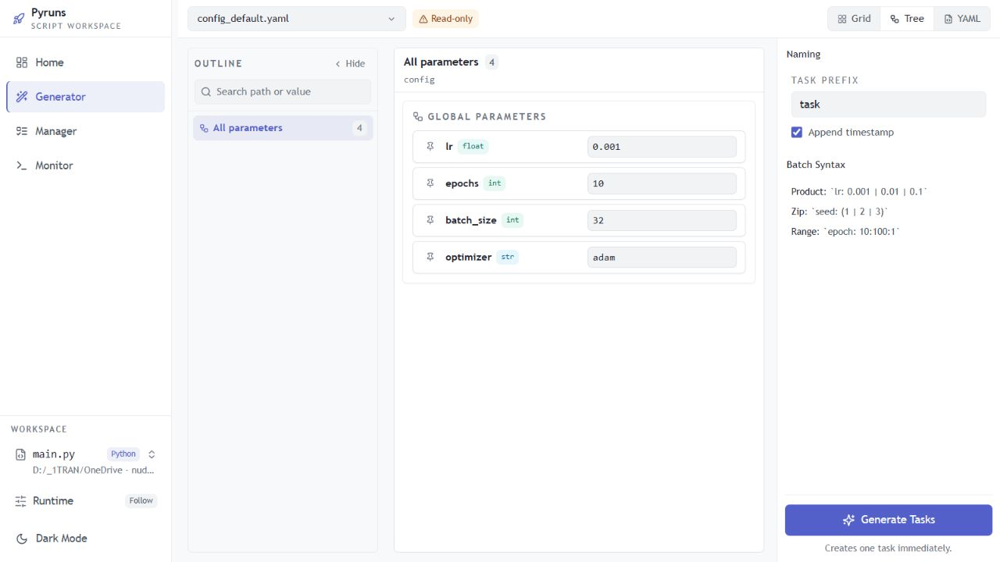
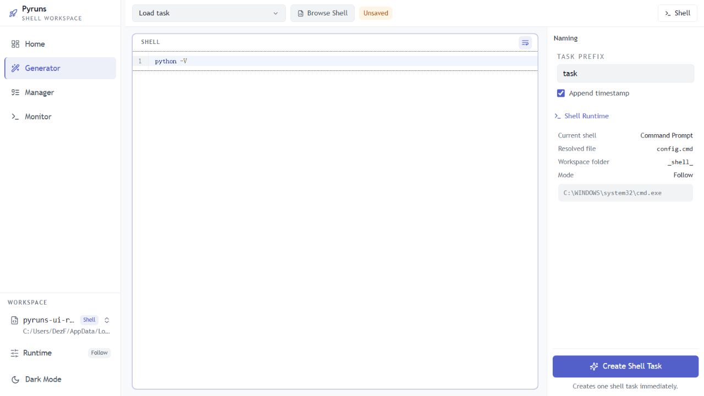
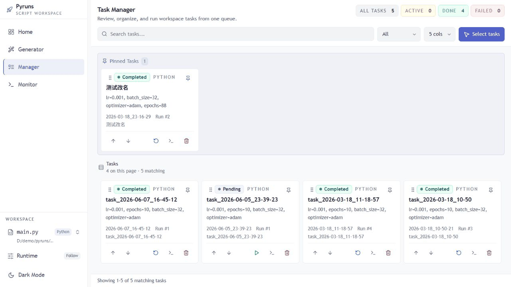
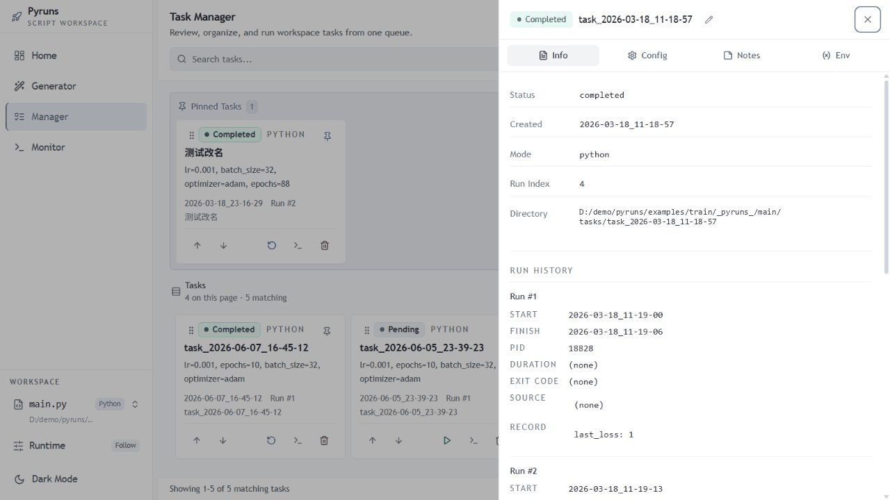
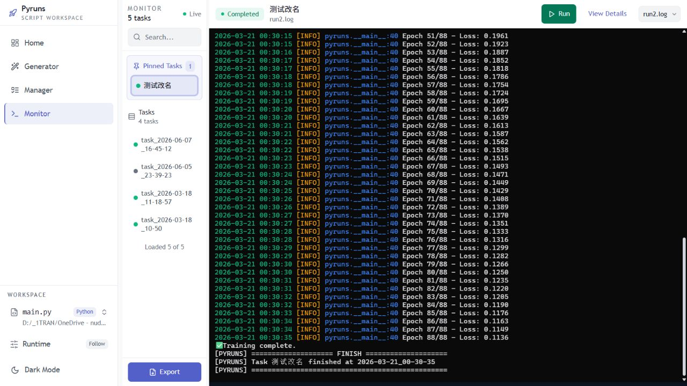
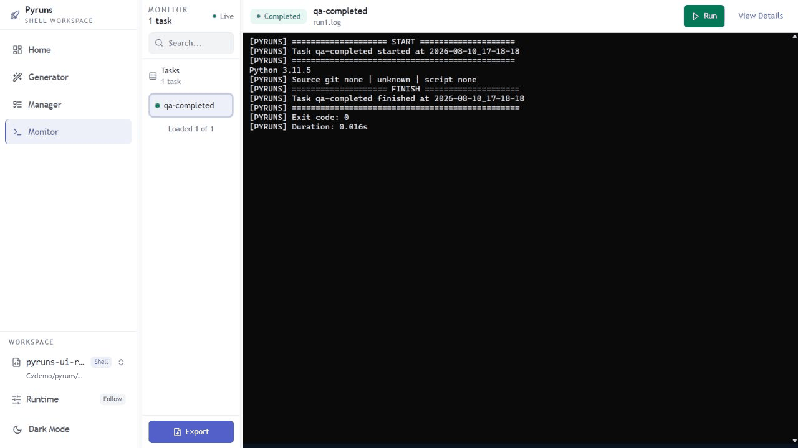

# UI 指南

当前的 Pyruns UI 已经不再是“附带页面”，而是一套真正承担主流程的 React 工作台。  
它的目标不是做得花，而是做得顺、做得稳、做得像你每天真的会打开的工具。

Web UI 必须显式启动；裸 `pyr` 或 `pyruns` 只显示 CLI 帮助：

```bash
pyr ui
pyr ui train.py
pyr ui train.py --config configs/default.yaml
pyr ui shell
pyr ui shell --no-browser
```

服务只监听本机回环地址。启动时会生成新的随机访问令牌；浏览器首次打开完整 URL 后，
服务器写入持久的 `HttpOnly`、`SameSite=Strict` 会话 cookie，并重定向到不含令牌的
干净地址。会话在使用时自动续期，并可跨同一主机、端口和工作区的正常更新或重启保留；
只有清除浏览器数据或本地 `~/.pyruns/sessions` 状态后才需要重新打开最新 URL。
`--no-browser` 会在终端打印完整访问 URL，请勿共享。Pyruns UI 不是面向公网或多用户的服务。

## 新手引导

浏览器首次成功连接工作区时，会弹出欢迎框。点击“开始引导”可依次认识首页、
工作区选择、任务生成、任务管理、日志监控、运行环境，以及语言和明暗主题按钮。
点击高亮的导航入口可以进入真实页面，也可以使用“下一步”和“上一步”。

工作区与运行设置在引导中仅供预览，不会创建任务、执行命令或保存运行配置。
有未保存的草稿时，需要先保存草稿才能开始；关闭欢迎框不会丢弃草稿。
随时可以按 Esc 或点击“跳过”退出，引导打开的预览面板会一起关闭。

欢迎框在同一浏览器中只自动显示一次。之后可以从侧栏或偏好设置中的“新手指南”
重新打开。引导跟随当前界面语言和主题；禁止浏览器存储时仍可使用，但刷新后无法
记住完成状态。

## 页面整体气质

这一版 UI 的收口方向很明确：

- 更紧凑
- 更有层级
- 更少噪声
- 更像实验工作台，而不是资讯面板



## 侧边栏与工作区

左下区域会显示当前：

- workspace 路径
- 当前脚本名，或 `_shell_`
- shell runtime 来源

长文本支持悬停查看完整内容，这一点在深层路径和 shell workspace 下尤其重要。

### 切换脚本工作区

选择一个 `.py` 文件后，Pyruns 会定位它旁边的：

```text
<project>/_pyruns_/<script_name>/
```

### 切换 Shell Workspace

从脚本工作区切换到 shell workspace 后，当前工作区会变成：

```text
<project>/_pyruns_/_shell_/
```

脚本和配置发现可以通过 `Cancel` 或 `Escape` 取消，读取超过 10 秒会提示重试。
已经提交的工作区打开操作会等待结果。

### 在线更新与重启

关闭浏览器页面后，任务照常运行。按 `Ctrl+C` 退出 `pyr ui` 服务时，Web 进程会清理由它启动并负责的任务。通过 `pyr exec -d` 或 `pyr run -d` 启动的任务由独立 runner 管理，退出和重开 Web 服务期间可以继续运行。

侧栏版本按钮可以检查并安装新版本。检测到当前 Python 环境已经安装了另一个版本时，按钮会提示重启界面以载入该版本。

只重启 Web 界面时，已经由独立 CLI runner 启动的任务可继续执行。界面仍负责的运行与排队任务会先跑完。在线更新通过 pip 替换当前 Python 环境中的包，还会等待使用同一安装的 CLI 和 runner 结束。其他机器同步来的只读任务记录不参与判断。只共享 NFS 任务目录且各自安装 Pyruns 的机器需要分别更新。

多台机器共用同一份 Python 安装和更新协调目录时，Pyruns 只运行一次 pip。各机器确认本机已读到新版本后再启动 Web 服务。仍在运行旧版本的 Web 服务会在看到同一次成功更新、且本机相关任务结束后补重启。通过外部 pip 命令安装时，侧栏检测到版本变化后会提示手动确认重启。

确认时如果还有相关任务，Pyruns 会保存本次预约。排队任务和界面照常运行，符合条件后自动开始。侧栏时钟图标可以查看并取消预约。关闭承接预约的 Web 服务会清除预约，关闭浏览器页面可以继续等待。

等待框显示目标版本、已等待时间，以及请求受理、连接中断和服务恢复阶段。安装期间原 Web 服务会退出，页面无法读取实时 pip 安装进度，会自动尝试重连。等待较长时，“重新加载”只检查服务是否恢复，不会重复发起安装。

更新失败后，错误详情会保留在弹窗中，可以复制、关闭或重试。关闭后可从侧栏警告图标重新打开；服务重启返回的安装失败详情在刷新页面后仍可查看。后台仍在重启时，重试按钮暂不可用。

“无法确认所有工作区空闲”表示任务状态检查未完成，不等同于确认有任务在运行。检查会对并发状态写入最多重读三次；持续冲突、元数据损坏或文件访问失败时仍会阻止重启，并显示工作区路径和具体原因。请先按详情处理或稍后重试。

## Generator

Generator 是整个 UI 最像“工作台”的页面。

### 在脚本工作区

支持：

- `Grid`
- `Tree`
- `YAML`

#### Grid / Tree

适合：

- 调整多个参数
- 使用 batch 语法
- pin 常用字段

当前特点：

- `Grid` 适合快速扫描和编辑扁平参数，`Tree` 配合 Outline 按配置路径浏览
- 类型 chip 会按模板声明类型稳定显示
- pin 顶部参数不再强行重新排位，而是更强调状态变化
- batch 触发项会被单独标记
- 右侧固定生成区始终在视线里

#### YAML

适合：

- 直接编辑完整配置
- 一次只生成一个任务
- 想保留完整 YAML 语义的人

当前编辑器已经补上更强的高亮和更宽松的编辑空间。

### 在 Shell Workspace

固定为：

- `Shell`

特点：

- 编辑的是脚本正文
- 每次只生成一个任务
- 落盘文件为当前 runtime 对应的 `config.ps1` / `config.cmd` / `config.sh`
- 默认跟随启动 Web UI 时的终端语义执行



Shell 编辑器支持 `Ctrl+/`（macOS 用 `⌘+/`）给当前行或选中的多行切换注释。Bash 和 PowerShell 使用 `#`，CMD 使用 `REM`。点击编辑器右上角的键盘图标可查看查找替换、移动行、缩进和撤销等快捷键。

创建按钮上方的「仅限本机执行」默认沿用工作区的 Runtime 设置。勾选后，任务保存到界面所示主机的专属目录。取消勾选后，任务保存到 `tasks/`，共享工作区的设备都可执行。其他设备同步后仍可在 Manager 或 Monitor 查看这些任务及日志。

浏览器按工作区记住「仅限本机执行」和「追加时间戳」的选择，刷新页面或继续创建时会恢复。将保存位置切回工作区默认值后，后续会沿用 Runtime 设置。「在任务管理中打开」会打开本次创建的第一个任务。要批量运行，在 Manager 点击「选择任务」，勾选任务并设置并发数即可。

“来源模板只读”只限制保存回该模板；当前任务草稿仍然可以编辑和生成任务。

## Runtime：运行环境与 GPU 调度

GPU 等待（GPU wait）是 UI 的任务调度规则，适合在共享 GPU 机器上按显存与空闲率排队运行任务。

侧栏 `Runtime` 面板按 `Python`、`Env`、`GPU` 三个标签组织运行设置。Python 和环境变量设置用于后续从 UI 提交的任务；GPU 设置是项目运行时的持久化调度规则。修改后必须点击 `Save`，标签上的未保存标记会提示尚未写入；`Reset` 恢复当前已保存值。

### GPU scheduling / GPU wait

在 `Runtime -> GPU` 打开 `GPU scheduling` 后，UI 只会在 GPU 满足规则时启动之后提交的任务。它是 UI 的持续设置，作用于后续 UI 任务；CLI 的 `pyr exec` / `pyr run` 仍须在单次命令中显式传入 `--gpu-wait`。关闭 UI 开关或不传 CLI 参数都表示不等待 GPU。

| UI 字段 | 含义 |
| --- | --- |
| `GPUs required` | 一次任务需要同时满足条件的 GPU 数量；多张卡必须一起达标 |
| `Minimum free memory (GiB)` | 每张候选卡最低空闲显存，单位固定为 GiB |
| `Minimum GPU idle (%)` | 每张候选卡最低空闲率；空闲率等于 `100 - GPU utilization` |
| `Stable for (sec)` | 显存和空闲率连续达标的秒数；`0` 表示立即启动 |
| `Maximum wait (hr)` | 启动前最长排队时间；`0` 表示不限时，不限制任务开始后的运行时间 |

在 `Runtime → Env` 中设置 `CUDA_VISIBLE_DEVICES=1,3`，可为整个工作区指定候选卡。在任务详情的 Env 中设置同一变量，可覆盖工作区默认值。调度开启后，Pyruns 会在最终的可见范围内挑出「所需 GPU 数量」指定的卡数。留空值表示没有可见 GPU，删除这一行则继承启动环境。

GPU 页可设置多卡同型号检查。已有固定卡号或忽略可见范围的工作区会显示当前策略。点击「按 CUDA_VISIBLE_DEVICES 选卡」并保存，才会启用新的选择方式。如需沿用原先的候选卡，先把编号写入工作区 Env。

启动 Pyruns 的进程环境是基础值，优先级最低。Runtime 的 Env 覆盖同名的基础值，任务自身的 Env 再覆盖 Runtime 的值。GPU 调度用合并后的环境做启动前检查，并在需要时为本次进程注入分配后的 `CUDA_VISIBLE_DEVICES`。脚本启动后可通过 `export` 等赋值修改自身及后续子进程的环境。需要限制调度选卡时，应在 Env 中提前设置变量。

GPU 等待参数直接显示在 GPU 页。关闭调度时可以查看当前阈值，开启后可修改。硬件预览检查当前显存、空闲率与型号条件。实际启动还会检查可见范围、GPU 预留和稳定时间。指标缺失时会继续等待有效读数。

任务进入排队后，Monitor 会显示 `Waiting for GPU capacity`、已就绪/所需卡数、稳定时间、剩余等待时间以及每张 GPU 的显存、空闲率、预留和缺失指标等阻塞原因。完整的 CLI 五段规则、单位、指定卡写法和 `ready` / `blocked` 输出见 [GPU 空闲等待规则](cli-guide.md#gpu-wait)。

## Manager

Manager 是任务的调度台。  
你不只是看见任务，而是要快速决定“接下来对它做什么”。

任务卡片、详情和 Monitor 会在有记录时显示执行主机。共享 NFS 工作区中，“取消待确认”表示已提交取消请求但还没有最终结果；“执行器状态待确认”表示记录的租约已过期，不代表远端进程已经停止。这些提示不会直接把任务改成完成或失败。Monitor 的连接标记描述日志连接，任务状态单独展示；首页系统资源则标明实际采集主机，不代表所有执行机器的汇总。

在运行环境面板的 Python 页签，通过「新任务保存位置」选择「通用任务目录」或「本机专属任务目录」，然后保存。默认使用通用目录。选择本机目录适合多台设备通过 Git 同步同一项目且各自独立运行实验的情况。该选项也可通过 `pyr config set task_storage local` 或 `pyr config set task_storage shared` 设置。

任务管理和日志监控的标题旁都有「任务来源」筛选器。默认全选，可单独勾选通用、本机或同一工作区中的其他设备，也可以取消全部勾选。两个页面共用浏览器为当前工作区保存的选择，搜索、分页和数量统计都随之更新。异机任务显示任务原名和主机名，筛选器遇到同名设备时会补充区分用的短码。其他设备的专属目录支持只读查看详情和日志。“上次报告为运行中”表示源机写下的状态，终态同步后会更新。首页的「本机运行中」只统计归属本机且心跳有效的任务。

本机目录由主机名和系统身份决定。同一系统的 Git checkout 使用相同的相对目录。即使 hostname 相同，Windows 和 WSL 的任务目录也分别对应各自的执行环境。不同设备各自创建的本机任务可以在 Git 中合并。两个 checkout 同时修改同一文件时仍按 Git 的规则合并。



### 你可以做什么

- 搜索任务
- 按状态筛选
- 选择多个任务批量运行 / 删除
- pin 任务
- 查看详情
- 直接跳转 Monitor 日志

### 当前交互约定

- 顶部工作区统计可直接点击筛选；`Active` 同时包括排队和运行中的任务。统计始终显示整个工作区的数量，不随当前搜索或分页改变
- 点击当前排序名称可展开“显示选项”，调整完整状态筛选、排序和卡片列数；按 Esc 或点击外部关闭，修改即时生效。搜索范围、大小写、全词和正则选项集中在搜索框右侧的筛选入口，启用后会在搜索框下方显示
- 工具栏支持卡片 / 列表切换，记住当前浏览器的视图偏好；切换时保留搜索、排序、分页和已选任务。列表在宽屏中横向排布，在窄屏中自动折行
- 所有排序方式都会先分出置顶任务，再分别排序。智能优先把运行中和排队中的任务放在组内前面。按同一活动优先级比较时，未手动排序的任务按最近活动排列，手动排序的任务随后按保存的位置排列
- “最近活动”与“最早活动”优先取最后一轮的结束时间，其次是该轮开始时间，最后才用创建时间。按名称排序会比较数字大小，例如 A–Z 下 `run2` 在 `run10` 之前
- 拖动任务或使用卡片上的上移、下移会保存位置并切换到“手动排序”。手动排序模式下，各组内有保存位置的任务排在前面
- 主按钮、危险按钮、次按钮已经尽量统一语义
- 卡片底部动作保持紧凑，减少鼠标移动距离
- 搜索框默认检索全部字段，可选择任务名、备注、Python 配置、Shell 脚本、任务 Env 或完整日志，并组合区分大小写、全词和正则匹配

搜索按原样保留空格与换行，默认不区分大小写。按 `Enter` 立即搜索，`Shift+Enter` 插入换行；多行文本必须在同一个字段或日志文件内连续出现。

Manager 和 Monitor 均支持 `Ctrl/Cmd+Shift+F` 聚焦并选中查询。在首行按 `↑` 回看历史，在末行按 `↓` 返回较新的查询，最后回到未提交的草稿；多行输入内部仍按普通光标键移动。最近 100 条查询在当前浏览器保存、去重并由两页共用，可在搜索设置中清空。自动搜索的历史延迟 2 秒记录，避免保存连续输入的每一步。

搜索框旁的筛选按钮提供搜索设置：默认边输入边搜索、等待 300 ms、最多 20,000 个匹配。结果分批出现，达到上限后会提示，可选择不限制数量重新搜索。设置在 Manager 和 Monitor 间共用并保存在当前浏览器。搜索结果不会定时重扫，日志或任务变化后使用刷新按钮更新；搜索中点击停止按钮或按 `Escape` 可以取消。

完整日志搜索使用随依赖安装的 ripgrep，按原始 UTF-8 文件内容匹配；颜色转义仅在结果预览中隐藏。扫描期间就会显示已找到的匹配，不必等当前日志文件读完；后续进度合并推送，减少界面刷新开销。点击结果仍会打开对应历史日志的匹配位置。日志追加、重写或替换后，下次搜索会重新检查文件。

### 任务详情面板

常见标签包括：

- `Info`
- `Config`
- `Notes`
- `Env`

其中：

- `Info` 显示任务模式、目录和完整 Run History
- 展开一条运行记录后，点击 `Saved input` 查看启动前保存的脚本或配置；点击 `Compare runs`，选择同一工作区中的任务名与运行编号，比较输入、汇总指标、耗时、状态、Git 来源与运行环境。默认选择本任务的上一次运行，可直接输入其他任务名与编号。
- 比较内容仅在点击时读取，不加载训练曲线。旧运行没有保存输入时会明确提示，其余已记录信息仍可比较；正在运行的记录显示本次读取时的值。
- `python` 任务显示 `config.yaml`
- `shell` 任务显示当前 runtime 对应的 `config.ps1` / `config.cmd` / `config.sh`

Notes 和 Env 保存会检查编辑时的字段值与任务身份。若原任务被同名任务替换，草稿仍保留，
请关闭并重新打开详情后再编辑新任务；旧草稿不能直接覆盖新任务。



## Monitor

Monitor 的目标不是“把日志显示出来”，而是把日志变成一个可工作的界面。



### 默认行为

- 直接从侧边栏或 tab 进入时默认不选中任何任务
- 只有从任务卡片或 Dashboard 显式跳转时，才会带着当前任务进入
- 当前选中的任务消失时会清空选中状态，不会自动跳到别的任务

### 日志查看

当前实现重点：

- xterm 实例只初始化一次
- 切任务时避免重复 reset
- 请求带竞态保护，避免旧响应覆盖新内容
- websocket chunk 会校验任务身份，避免串日志

切换任务或日志时，Monitor 先加载末尾最多 256 KiB。点击「加载更多历史日志」可在原有滚动行数限制内把上限扩展到 4 MiB。`monitor_scrollback=0` 关闭终端历史滚动，当前屏幕仍显示初始尾部与新增输出。日志连接成功读取文件状态后才显示 `Live`；持续读盘失败会显示提示，并尝试重连与增量读取，正常无输出的任务仍保持连接。

日志面板显示当前选定的日志内容；完整原始日志始终保存在任务目录中，可直接从任务目录读取或归档。`Copy current log` 只复制当前已加载的内容。

浏览器标签页进入后台时，Monitor 暂停任务事件和实时日志连接；返回时更新任务状态，并从已接收的位置继续读取日志。Manager、Monitor 和 Dashboard 的定时刷新也会在后台暂停，返回时立即补刷。搜索结果仍需使用刷新按钮更新。

Monitor 收到任务变更事件后读取服务端已有快照，合并短时间内的连续事件。连接正常时，前端额外每 60 秒发起一次磁盘校验请求，断连时改为每 5 秒重试；手动刷新会立即同步磁盘。服务端的任务调度和磁盘发现仍按自身周期运行。

实时订阅期间，服务端约每秒检查目录和任务状态，约每 4 秒校验配置、脚本内容；任务元数据发生变化时会一起加载最新配置。网页请求与调度器共享扫描结果，慢扫描结束后才开始计算下次间隔。外部编辑配置后可使用手动刷新立即同步。

### 导出

Monitor 支持选择多个任务并导出任务指标 CSV；日志文件保存在各任务目录中。



## Dashboard

Dashboard 是第一页，也是最适合做“工作区展示图”的页面。

现在它主要承担：

- 当前 workspace 的任务摘要和最近任务
- CPU / RAM / GPU 状态
- 多 GPU 卡片布局
- GPU 显存占用与进程明细入口

系统指标与任务摘要独立加载和刷新，任务目录读取较慢时不会阻塞已返回的 GPU 指标。切回 Home 会先展示本次会话中上次成功获取的系统指标，并立即在后台刷新；更新时间和刷新状态会显示在资源区域。首次加载、请求失败和未检测到 GPU 会分别提示，刷新失败时保留上次的数据；切换工作区会清除这份缓存。

Home 的周期请求只取任务概览，不重新枚举模板目录；模板仍在工作区和 Generator 中按需加载。直接调用 `/api/dashboard` 默认保留完整响应，可传 `include_workspace=false` 省略工作区详情和模板数量。

## 四页统一设计语言

当前 UI 的统一目标包括：

- section 结构统一
- pin 语义统一为紫色
- 选中态统一
- 信息密度更高但不显得挤
- 一致的搜索框、对话框、状态 badge 和 action button

相似组件尽量共享同一套语言，这样用户不用每页重新学习一次。
